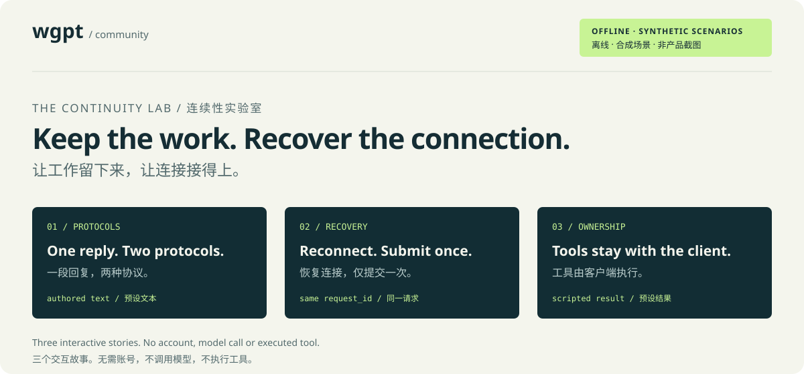

# wgpt community

**Explore the ideas. Help make them dependable.** This repository hosts offline demonstrations, the contribution agreement and contributor onboarding. Development of wgpt takes place in the private [DapengFeng/wgpt](https://github.com/DapengFeng/wgpt) repository after an invitation is accepted.

**探索设计，一起让它更可靠。** 本仓库提供离线演示、贡献者协议及接入流程。接受邀请后，在私有仓库 [DapengFeng/wgpt](https://github.com/DapengFeng/wgpt) 中开发 wgpt。

wgpt's mission is to make website-based AI a dependable collaborator for coding agents and SDK applications through a local, recoverable bridge. This public repository does not mirror its private source, releases, issues, account data or client transcripts. Do not copy private repository contents into a public issue, pull request or fork.

wgpt 的使命是通过可恢复的本地 bridge，让网页端 AI 成为编程 agent 和 SDK 应用可靠的协作者。本公开仓库不镜像私有源码、发布产物、issue、账号数据或客户端会话。不要将私有仓库内容复制到公开 issue、PR 或 fork。

## Try the continuity lab / 体验连续性实验室

[](demos/README.md)

See how a recoverable bridge can keep a task moving: translate one reply into two client protocols, recover an interrupted request without a second submission, and carry a tool call while keeping execution with the client. The [interactive lab](demos/README.md) opens locally in your browser and needs no account, API key or wgpt installation.

看看可恢复 bridge 如何让任务继续：将一段回复转换为两种客户端协议、中断后恢复原请求而不重复提交，以及传递工具调用并将执行留在客户端。[交互实验室](demos/README.md)在本地浏览器打开，无需账号、API key 或安装 wgpt。

These are independently authored **offline, synthetic illustrations**, not live provider recordings, product screenshots or a running wgpt service. The demo makes no provider requests and executes no tools. It demonstrates design ideas, not current website compatibility or provider authorization. [Scope, sources and walkthroughs](demos/README.md#scope-and-sources) explain the boundary.

这些是独立编写的**离线合成示意**，不是实站 provider 录像、产品截图或运行中的 wgpt 服务。演示不向 provider 发请求，也不执行工具；它展示设计理念，不能证明当前网站兼容性或 provider 授权。[范围、依据与说明](demos/README.md#scope-and-sources)解释了具体边界。

## Join the project / 参与项目

1. Read [CONTRIBUTING](CONTRIBUTING.md), the current [CLA](CLA.md) and the [Code of Conduct](CODE_OF_CONDUCT.md).

   阅读[贡献指南](CONTRIBUTING.md)、当前 [CLA](CLA.md) 和[行为准则](CODE_OF_CONDUCT.md)。

2. Fork this public repository. Add `contributors/<your-github-login>.md` with your GitHub handle and a short, non-sensitive statement of your contribution interests, then open a pull request against `main`.

   Fork 本公开仓库，新增 `contributors/<你的 GitHub 用户名>.md`，填写 GitHub 用户名和简短、不敏感的贡献意向，再向 `main` 提交 PR。

3. The CLA bot posts the exact signing statement for the current agreement version and SHA-256. If you agree, copy that whole statement into a **new comment authored by you on your PR**. A checkbox, commit signature or another person's comment is not a CLA signature.

   CLA bot 会发布包含当前协议版本及 SHA-256 的准确签署声明。若你同意，将整段声明复制为**由你本人在自己的 PR 下新发的一条评论**。勾选框、commit 签名或他人评论均不能代替 CLA 签署。

4. Once the signature is valid, the invitation reconciler can invite you to the private repository. Accept GitHub's invitation, then create development branches and pull requests there. The onboarding PR does not need to merge before the invitation is sent.

   签署有效后，邀请同步任务即可邀请你加入私有仓库。接受 GitHub 邀请后，在该私有仓库中建立开发分支并提交 PR。邀请发送前不要求合入接入 PR。

The private repository belongs to a personal account: collaborators receive **read/write access, not read-only or administrator access**. Any eligible signer is invited automatically; signing is not a request for a separate manual selection. The reconciler is scheduled every 20 minutes, but GitHub can delay or disable scheduled runs. See [permissions, configuration and recovery](CONTRIBUTING.md#maintainer-operations--维护者操作).

私有仓库属于个人账号：协作者获得**读写权限，而非只读或管理员权限**。满足条件的签署者会被自动邀请；签署不代表再等待另一次人工筛选。邀请同步任务计划每 20 分钟执行一次，但 GitHub 可能延迟或停用定时运行。详见[权限、配置及恢复说明](CONTRIBUTING.md#maintainer-operations--维护者操作)。

## Public records and withdrawal / 公开记录与撤回

Signatures are recorded on the [`cla-signatures` branch](https://github.com/DapengFeng/wgpt-community/tree/cla-signatures) with GitHub identities, comment references and agreement version/hash. Do not supply email addresses, identity documents, passwords or tokens. Editing or deleting a signing comment invalidates that signature; it stops eligibility for new automatic invitations and causes the CLA check to fail until a valid signature is supplied. Already accepted repository access is not automatically removed. [CONTRIBUTING](CONTRIBUTING.md#signature-records-and-withdrawal--签署记录与撤回) explains retention and access changes.

签署信息记录在 [`cla-signatures` 分支](https://github.com/DapengFeng/wgpt-community/tree/cla-signatures)，包含 GitHub 身份、评论引用及协议版本/哈希。不要提交邮箱、身份证件、密码或令牌。编辑或删除签署评论会使该签署失效，停止新的自动邀请资格，并使 CLA 检查失败，直到补充有效签署。已经接受的仓库权限不会自动移除。[贡献指南](CONTRIBUTING.md#signature-records-and-withdrawal--签署记录与撤回)说明记录保留及权限变更方式。

## Development and verification / 开发与验证

The CLA and invitation automation uses Python's standard library; demo regression tests also use Node.js 18 or newer and its built-in test runner. Run the offline synthetic tests from this repository root:

CLA 和邀请自动化使用 Python 标准库；演示回归测试还使用 Node.js 18 或更新版本及其内置测试运行器。在本仓库根目录执行离线合成测试：

```bash
python3 -m unittest discover -s tests
```

Offline tests do not prove that GitHub permissions, an external contributor's signature, the invitation and its acceptance work together. Hosted end-to-end acceptance remains open until a real external-account run is recorded. Maintainers should follow the [deployment and acceptance procedure](CONTRIBUTING.md#deployment-and-acceptance--部署与验收), rather than treating a passing local test as deployment evidence.

离线测试不能证明 GitHub 权限、外部贡献者签署、邀请及接受邀请的完整链路有效。完成并记录真实外部账号测试前，托管端到端验收仍未完成。维护者应遵循[部署与验收流程](CONTRIBUTING.md#deployment-and-acceptance--部署与验收)，不能将本地测试通过当作部署证据。

This repository's own material is provided under the [MIT license](LICENSE). The [CLA](CLA.md) defines the contribution agreement; it does not grant rights to third-party services, accounts, content or trademarks.

本仓库自身材料采用 [MIT 许可证](LICENSE)。[CLA](CLA.md)规定贡献协议，不授予第三方服务、账号、内容或商标的权利。
