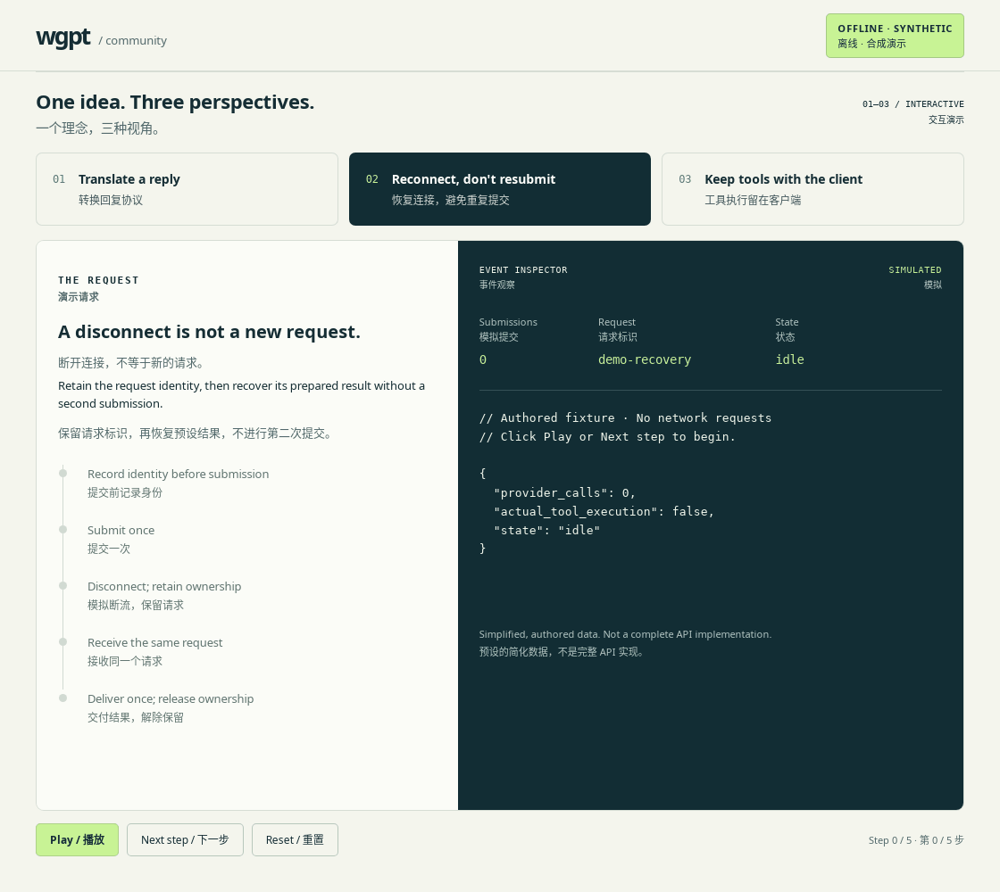
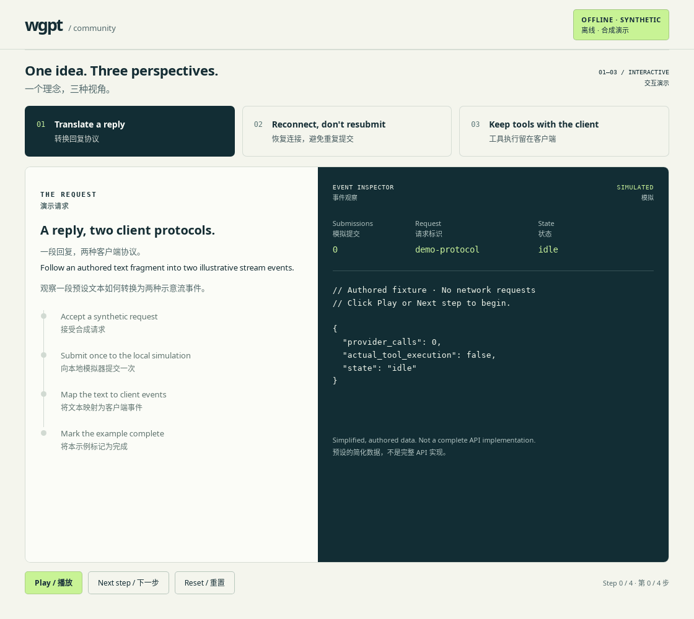
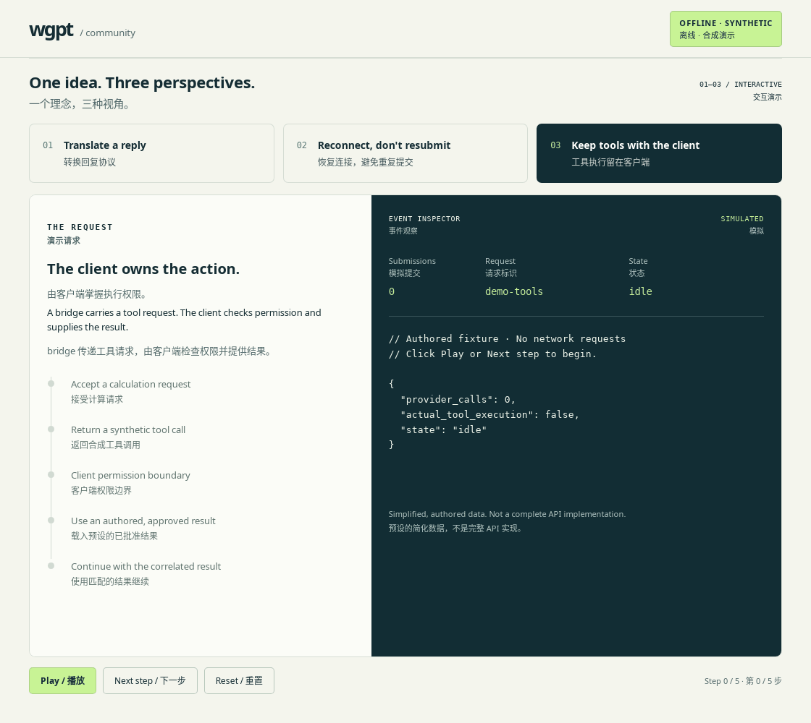

# wgpt community

**Explore the ideas. Help make them dependable.** This repository hosts offline demonstrations, the contribution agreement and contributor onboarding. Development of wgpt takes place in the private [DapengFeng/wgpt](https://github.com/DapengFeng/wgpt) repository after an invitation is accepted.

**探索设计，一起让它更可靠。** 本仓库提供离线演示、贡献者协议及接入流程。接受邀请后，在私有仓库 [DapengFeng/wgpt](https://github.com/DapengFeng/wgpt) 中开发 wgpt。

wgpt's mission is to make website-based AI a dependable collaborator for coding agents and SDK applications through a local, recoverable bridge. This public repository does not mirror its private source, releases, issues, account data or client transcripts. Do not copy private repository contents into a public issue, pull request or fork.

wgpt 的使命是通过可恢复的本地 bridge，让网页端 AI 成为编程 agent 和 SDK 应用可靠的协作者。本公开仓库不镜像私有源码、发布产物、issue、账号数据或客户端会话。不要将私有仓库内容复制到公开 issue、PR 或 fork。

## Watch the continuity lab / 观看连续性实验室

Watch directly on GitHub—no installation, account or deployment needed. These GIFs record the existing **offline HTML simulation** using synthetic data and its **Next step** control. Frame hold times are edited for readability; no wgpt service, AI provider or client tool runs in these scenarios.

直接在 GitHub 观看，无需安装、账号或部署。这些 GIF 录制自现有的**离线 HTML 模拟页面**，使用合成数据及其 **Next step（下一步）** 控件。各帧停留时间经过调整，方便阅读；场景不运行 wgpt 服务、不调用 AI provider，也不执行客户端工具。

**Reconnect, don't resubmit.** Follow one simulated request through interruption and recovery; its submission counter stays at **1**.

**恢复连接，避免重复提交。** 观察同一模拟请求中断后恢复；提交计数始终保持为 **1**。



[Open recovery animation / 单独打开恢复动画](demos/recordings/recovery.gif)

<details>
<summary>One reply, two protocols / 一段回复，两种协议</summary>

The same scripted reply appears in two illustrative client stream events.

同一段预设回复出现在两种示意客户端流事件中。



[Open protocol animation / 单独打开协议动画](demos/recordings/protocol.gif)

</details>

<details>
<summary>The client owns execution / 执行由客户端掌握</summary>

A synthetic tool call receives a scripted client approval and a matching result; no tool executes.

合成工具调用经过预设客户端批准，再接收匹配的结果；没有实际执行工具。



[Open tool animation / 单独打开工具动画](demos/recordings/tools.gif)

</details>

GIFs may animate automatically and play once without looping. For reduced-motion viewing, use the [static overview](demos/overview.svg); the [demo guide](demos/README.md) also provides written walkthroughs and an optional interactive version. These are recordings of synthetic teaching scenarios, not live product/provider footage, compatibility evidence or provider authorization. See [scope and sources](demos/README.md#scope-and-sources).

GIF 可能自动播放，播放一次后停止，不循环。需要减少动态内容时，可查看[静态概览](demos/overview.svg)；[演示指南](demos/README.md)还提供文字说明及可选交互版本。这些录像记录的是合成教学场景，并非产品／provider 实站录像，也不能证明兼容性或 provider 授权。详见[范围与依据](demos/README.md#scope-and-sources)。

## Join the project / 参与项目

1. Read [CONTRIBUTING](CONTRIBUTING.md), the current [CLA](CLA.md) and the [Code of Conduct](CODE_OF_CONDUCT.md).

   阅读[贡献指南](CONTRIBUTING.md)、当前 [CLA](CLA.md) 和[行为准则](CODE_OF_CONDUCT.md)。

2. Fork this public repository. Add `contributors/<your-github-login>.md` with your GitHub handle and a short, non-sensitive statement of your contribution interests, then open a pull request against `main`.

   Fork 本公开仓库，新增 `contributors/<你的 GitHub 用户名>.md`，填写 GitHub 用户名和简短、不敏感的贡献意向，再向 `main` 提交 PR。

3. The CLA bot posts the exact signing statement for the current agreement version and SHA-256. If you agree, copy that whole statement into a **new comment authored by you on your PR**. A checkbox, commit signature or another person's comment is not a CLA signature.

   CLA bot 会发布包含当前协议版本及 SHA-256 的准确签署声明。若你同意，将整段声明复制为**由你本人在自己的 PR 下新发的一条评论**。勾选框、commit 签名或他人评论均不能代替 CLA 签署。

4. After `cla/signature` passes, wait for the public repository owner to review your request and select **Review changes → Approve** on its current commit. Signing alone does not grant access. Keep the onboarding PR open until you accept GitHub's invitation, then create development branches and pull requests in the private repository.

   `cla/signature` 通过后，等待公开仓库所有者审阅申请，并对当前提交选择 **Review changes → Approve**。仅签署协议不会授予访问权限。接受 GitHub 邀请前保持接入 PR 开放；接受后，在私有仓库中建立开发分支并提交 PR。

The private repository belongs to a personal account: collaborators receive **read/write access, not read-only or administrator access**. Invitations require both a valid CLA signature and the owner's approval submitted after that signature for the current PR head. Comments, labels and bot reviews do not qualify. After approval, the reconciler is scheduled every 20 minutes; GitHub can delay or disable scheduled runs, and the owner can dispatch it from trusted `main`. See [permissions, configuration and recovery](CONTRIBUTING.md#maintainer-operations--维护者操作).

私有仓库属于个人账号：协作者获得**读写权限，而非只读或管理员权限**。邀请同时要求有效 CLA 签署，以及所有者在该签署之后针对当前 PR head 提交的批准审阅。评论、标签和 bot 审阅均不能代替批准。批准后，邀请同步任务计划每 20 分钟执行一次；GitHub 可能延迟或停用定时运行，所有者也可从可信的 `main` 手动调度。详见[权限、配置及恢复说明](CONTRIBUTING.md#maintainer-operations--维护者操作)。

## Public records and withdrawal / 公开记录与撤回

Signatures are recorded on the [`cla-signatures` branch](https://github.com/DapengFeng/wgpt-community/tree/cla-signatures) with GitHub identities, comment references and agreement version/hash. Do not supply email addresses, identity documents, passwords or tokens. Editing or deleting a signing comment invalidates that signature; it stops eligibility for new automatic invitations and causes the CLA check to fail until a valid signature is supplied. Already accepted repository access is not automatically removed. [CONTRIBUTING](CONTRIBUTING.md#signature-records-and-withdrawal--签署记录与撤回) explains retention and access changes.

签署信息记录在 [`cla-signatures` 分支](https://github.com/DapengFeng/wgpt-community/tree/cla-signatures)，包含 GitHub 身份、评论引用及协议版本/哈希。不要提交邮箱、身份证件、密码或令牌。编辑或删除签署评论会使该签署失效，停止新的自动邀请资格，并使 CLA 检查失败，直到补充有效签署。已经接受的仓库权限不会自动移除。[贡献指南](CONTRIBUTING.md#signature-records-and-withdrawal--签署记录与撤回)说明记录保留及权限变更方式。

## Development and verification / 开发与验证

The CLA and invitation automation uses Python's standard library; demo regression tests also use Node.js 18 or newer and its built-in test runner. Run the offline synthetic tests from this repository root:

CLA 和邀请自动化使用 Python 标准库；演示回归测试还使用 Node.js 18 或更新版本及其内置测试运行器。在本仓库根目录执行离线合成测试：

```bash
python3 -m unittest discover -s tests
```

Offline tests do not prove that GitHub permissions, an external contributor's signature, owner approval, the invitation and its acceptance work together. Hosted end-to-end acceptance remains open until a real external-account run is recorded. Maintainers should follow the [deployment and acceptance procedure](CONTRIBUTING.md#deployment-and-acceptance--部署与验收), rather than treating a passing local test as deployment evidence.

离线测试不能证明 GitHub 权限、外部贡献者签署、所有者批准、邀请及接受邀请的完整链路有效。完成并记录真实外部账号测试前，托管端到端验收仍未完成。维护者应遵循[部署与验收流程](CONTRIBUTING.md#deployment-and-acceptance--部署与验收)，不能将本地测试通过当作部署证据。

This repository's own material is provided under the [MIT license](LICENSE). The [CLA](CLA.md) defines the contribution agreement; it does not grant rights to third-party services, accounts, content or trademarks.

本仓库自身材料采用 [MIT 许可证](LICENSE)。[CLA](CLA.md)规定贡献协议，不授予第三方服务、账号、内容或商标的权利。
